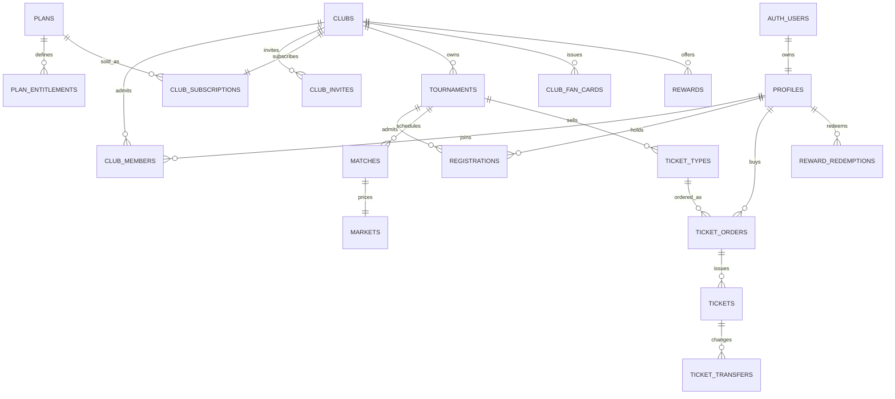

# MatchPulse — Domain Model

This page defines the entities, relationships, state changes and business rules.
The enforcement and test status for each rule is in the
[invariant registry](../methodology/checkpoint-A/02-invariants.md).

## 1. Entities

| Entity | Meaning | Storage |
| :--- | :--- | :--- |
| **Profile** | Global email/password identity with username and point balance. | `profiles` |
| **Club** | Paying tenant. Owns events, members, subscriptions and club-scoped data. | `clubs` |
| **Club membership** | Links a profile to a club as `OWNER`, `ADMIN`, `STAFF` or `ANALYST`. A user may belong to several clubs. | `club_members` |
| **Club invite** | Single-use, expiring invitation for an email and club role. | `club_invites` |
| **Platform admin** | Platform-level operator capability, separate from club roles. | `platform_admins` |
| **Plan / entitlement** | `STARTER`, `PRO`, `ELITE` and their feature/limit rows. | `plans`, `plan_entitlements` |
| **Subscription** | A club's plan and `ACTIVE`/`PAST_DUE`/`CANCELED` status. `ACTIVE` or `PAST_DUE` within the 7-day grace grants entitlements. | `club_subscriptions` |
| **Event (tournament)** | Club-owned competition with capacity, allocation and a `DRAFT`/`PUBLISHED`/`FINISHED`/`CANCELLED` status. | `tournaments` |
| **Registration** | Links a fan to an event and consumes one participant place. Legacy path for club-less events. | `registrations` |
| **Match** | Fixture with teams, kickoff, status, scores and a prediction flag. | `matches` |
| **Market** | Three-outcome LMSR market attached to a match. | `markets` |
| **Position / trade / payout** | A fan's holding, the trade log and the one-time resolution credit. | `market_positions`, `market_trades`, `market_payouts` |
| **Trade request** | Idempotency key for one entry or exit. | `trade_requests` |
| **Entry cooldown** | Per-profile, per-market re-entry gate. | `market_entry_cooldowns` |
| **Ticket type** | Club-defined sector, simulated price, allocation, sales window, buyer cap, fan-card/transfer/away rules. | `ticket_types` |
| **Ticket order** | Buyer's simulated order for 1–4 tickets, with terms, request id and `WEB`/`BOX_OFFICE` channel. | `ticket_orders` |
| **Ticket** | One nominal attendee ticket with identity fields, unique code and check-in time. Buyer may differ from attendee. | `tickets` |
| **Ticket transfer** | Previous and new attendee for a name change. | `ticket_transfers` |
| **Fan card** | Club-issued card number used by restricted ticket types. | `club_fan_cards` |
| **Reward / redemption** | Club-scoped points reward and its one-time local code. | `rewards`, `reward_redemptions` |
| **Audit event** | Actor, action, entity, optional club and metadata for sensitive actions. | `audit_events` |

## 2. Relationships

- A club has one owner; a partial unique index enforces it.
- A club has one subscription; only `ACTIVE` grants entitlements.
- A ticket type belongs to one event; an order belongs to one ticket type and one
  event; each ticket belongs to one order and one attendee.
- A buyer may hold several tickets for one event, up to the ticket type's
  cumulative cap.
- A club sees only its own events, orders, attendees and aggregate insights.

## 3. State changes

| Object | States | Trigger |
| :--- | :--- | :--- |
| Subscription | `ACTIVE` → `PAST_DUE` at period end; 7-day grace; `CANCELED` denies immediately | Platform admin, daily `pg_cron` expiry or simulated plan change |
| Event | `DRAFT` → `PUBLISHED` → `FINISHED` / `CANCELLED` | Club staff; publish requires an active ticket type |
| Ticket order | `SIMULATED_PAID` → `CANCELLED` | Simulated checkout; no real payment |
| Ticket | valid → checked in; transferable → new attendee | Staff check-in or buyer name change before the deadline |
| Match | `SCHEDULED` → `LIVE` → `FINISHED` | Club staff |
| Market | `OPEN` → `RESOLVED` | `resolve_market`; terminal, one-shot |
| Position | shares `> 0` → `0` | Exits; settlement pays winners |
| Trade request | `IN_PROGRESS` → `COMPLETED` or rollback | Idempotent entry/exit |
| Cooldown | level `0…40`; wait `5, 15, 30, 45, …` capped at `600 s` | Accepted entries escalate; quiet time decays; refusals do not change it |

## 4. User journeys

1. **Fan sign-up/sign-in:** email/password creates or restores a profile with
   200 points. No anonymous session.
2. **Club onboarding:** a user creates a club, becomes `OWNER`, chooses a
   simulated plan and invites staff. The platform admin can override the plan and
   status.
3. **Event setup:** staff create a draft event, ticket types with rules, matches
   and an optional market; publishing requires at least one active ticket type.
4. **Fan purchase:** a fan opens a published event, chooses a ticket type and 1–4
   attendees, enters identity data, accepts the terms and buys. The buyer cap is
   cumulative per event across orders and channels. The order is simulated; each
   ticket gets a code/QR.
5. **Check-in and name change:** staff check in by code (idempotent); a buyer may
   transfer a transferable ticket to a new named attendee before the deadline.
6. **Prediction:** once the market opens, a fan enters a points position, may
   exit part or all, and is subject to the entry cooldown. New entries stop when
   the match is `FINISHED`; exits remain available while the market is open.
   Retries are idempotent.
7. **Resolution:** club staff resolve the market once after the match is
   `FINISHED`, using the score-derived winner; winning shares pay one point each
   and losing shares pay nothing.
8. **Rewards:** a fan redeems points for a club reward if they have a ticket for
   that club; the code is local and simulated. Redemption is retry-safe with a
   request key.
9. **Insights:** club staff/analysts read aggregate prediction choices and
   engagement for their own events; each outcome/time-bucket cohort below 5 is
   suppressed and no attendee identity is included. `ELITE` can export CSV.
10. **Admin and retention:** the platform admin manages clubs/plans and reviews
    audit. A service-role cleanup removes attendee identity from past-event
    tickets, transfer history, old fan-card audit metadata and invitation emails
    after the retention window.

## 5. Business invariants

This is a summary. The [registry](../methodology/checkpoint-A/02-invariants.md)
is authoritative for enforcement, tests and fault-injection evidence.

| Rule | Enforcement | Status |
| :--- | :--- | :--- |
| Capacity is never exceeded under concurrency | Row lock, capacity check, CHECK constraints | Verified; fault-injected |
| A participant cannot register twice | Unique constraint + idempotent refusal | Verified; fault-injected |
| Entry/exit, position, balance and trade succeed or fail together | Single transaction | Verified by forced rollback (M-INV2) |
| Holdings never go negative | Position guard + non-negative constraints | Verified; fault-injected |
| Balance never goes negative | Profile lock + conditional debit | Verified; fault-injected |
| Resolution pays once, terminally, for the score-derived winner | Result-binding triggers + terminal state | Verified; fault-injected |
| Cooldown ladder and decay; exits never restricted | `open_trade` gate; `close_trade` exempt | Verified; fault-injected |
| No commission | No fee path; exact formulas | Verified; fault-injected |
| A caller is a real auth user; a fan acts only on their own rows | Auth, RLS, `auth.uid()` | Verified |
| Club data is isolated; roles and entitlements are enforced | Club-scoped RLS + RPC checks | Verified |
| Ticket sales stay within capacity/allocation; buyer cap is cumulative | Locks, triggers, configuration guard | Verified; partly fault-injected |
| Attendee identity is removable after retention | `cleanup_expired_attendee_data`; redaction | Verified; fault-injected |
| Insights suppress each outcome/time-bucket cohort below 5 | `club_prediction_insights` + privacy rule | Verified; fault-injected |

## Related documents

- [System overview](./01-system-overview.md)
- [Architecture characteristics](./03-architecture-characteristics.md)
- [Code map](./04-code-map.md)
- [Architecture description](./reports/2026-11-10.md)
