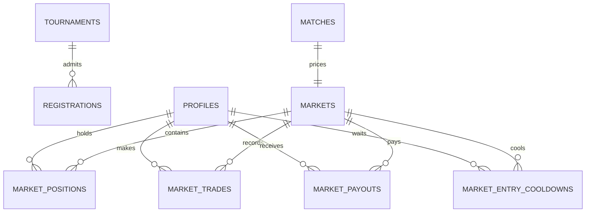

# MatchPulse — Domain Model

> **How to read this document.** It defines the entities, their relationships,
> the user journeys that exercise them, and the business invariants that must
> hold. Enforcement mechanisms and evidence are recorded per rule in the
> [invariants registry](../methodology/checkpoint-A/02-invariants.md). Runtime
> behaviour and infrastructure are described in the
> [system overview](./01-system-overview.md).

## 1. Entities

| Entity | Meaning | Storage | State |
| :--- | :--- | :--- | :--- |
| **Profile** | A participant. Stores a username and an available point balance. | `profiles` | Implemented (no authentication; seeded demo profile) |
| **Tournament** | A capacity-limited competition. `current_players` must match the stored registrations. | `tournaments` | Implemented |
| **Registration** | Links a profile to a tournament and consumes one place. | `registrations` | Implemented and verified |
| **Team** | A football team participating in a tournament. | — | Not implemented as a table; matches store team names as text |
| **Match** | A fixture with home and away team names, a kickoff timestamp and a status. | `matches` | Implemented |
| **Market** | A three-outcome market (HOME / DRAW / AWAY) attached one-to-one to a match. Holds the LMSR liquidity parameter `b` and the outstanding quantities `q`. | `markets` | Implemented (engine verified; UI prototype) |
| **Position** | A profile's holding in one outcome of one market, with its cost basis. | `market_positions` | Implemented (engine verified; UI prototype) |
| **Trade** | An accepted entry or exit: kind, outcome, shares, points moved, and implied odds before and after. This is the analytics-of-record dataset. | `market_trades` | Implemented; not yet aggregated or exported |
| **Payout** | The one-time resolution credit for a holder of winning shares. | `market_payouts` | Implemented and verified |
| **Entry cooldown** | The per-profile, per-market re-entry gate: current ladder level and next allowed entry. | `market_entry_cooldowns` | Implemented |
| **Points ledger** | An append-only record of every point movement. | — | Not implemented; `profiles.points`, trades and payouts record balances |

Two schema facts matter for reading the model correctly:

- `matches` is **not** linked to `tournaments`. Tournaments, registrations and
  matches are independent aggregates in the current schema.
- `registrations.user_id` is **not** a foreign key to `profiles`. Market tables
  do reference `profiles`; registration relies on the caller supplying a valid
  profile id.

## 2. Relationships

- A **match** has exactly one **market** (`markets.match_id` is unique).
- A **market** has at most one **position** per profile and outcome
  (`UNIQUE (market_id, user_id, outcome)`).
- Resolution writes at most one **payout** per profile and market
  (`PRIMARY KEY (market_id, user_id)`).
- A **cooldown** row exists at most once per profile and market
  (`PRIMARY KEY (market_id, user_id)`).

## 3. State transitions

| Object | States | Trigger |
| :--- | :--- | :--- |
| Match | `SCHEDULED` → `LIVE` → `FINISHED` | Staff / demo data. The market window does **not** read this status; it uses kickoff time and the market's own status |
| Market | `OPEN` → `RESOLVED` | `resolve_market`; terminal, with `winning_outcome` and `resolved_at` set |
| Position | shares `> 0` → `0` | Exits; a zero-share row may remain |
| Cooldown | level `0…40`; wait `5, 15, 30, 45, …` capped at `600 s` | Accepted entries escalate; five quiet minutes decay one level; refusals do not change it |

## 4. User journeys

1. **Organizer:** creates tournaments, manages teams, schedules matches and
   records final results. Resolving a market is an organizer operation;
   authorization is not yet enforced (INV-05).
2. **Fan registration (implemented):** registers for a tournament while
   capacity remains, and is told when it is full.
3. **Fan trading (implemented; engine verified, UI prototype):** once the match
   has started, commits points to one outcome at the current odds. The spectator
   may exit part or all of the position at any later moment before resolution;
   exits are never blocked or charged. Exiting settles at the current odds — a
   gain when the implied probability has risen, a proportional loss when it has
   fallen. Re-entry is cooled down (5 s, 15 s, 30 s, 45 s, … capped, decaying
   after quiet periods); refused attempts do not escalate.
4. **Resolution (implemented and verified):** when staff finalise a result, the
   market resolves once and terminally. Each winning share pays exactly one
   point; losing shares pay nothing. No trade is accepted afterwards.
5. **Rewards:** accumulated points can be redeemed for future ticket discounts.
   *Not implemented.*
6. **Club analytics:** clubs purchase aggregated crowd-sentiment insights
   derived from market activity over time. *Not implemented; the trade log is
   designed to support it. Export and privacy rules are not implemented
   (INV-05).*

The request-level sequence for trading, resolution and registration is in the
[system overview](./01-system-overview.md#4-data-flows).

## 5. Business invariants

This is a summary. The [registry](../methodology/checkpoint-A/02-invariants.md)
is authoritative for enforcement details, test names and fault-injection
evidence.

| Domain rule | Enforcement | Status |
| :--- | :--- | :--- |
| Tournament capacity is never exceeded under concurrency; the stored counter matches stored rows | `register_for_tournament` + CHECK constraints | **Verified** (INV-01, fault-injected, CI) |
| A participant cannot register twice for a tournament | Unique constraint + idempotent refusal | **Verified** (INV-02, fault-injected, CI) |
| Trading opens only at kickoff and stops at resolution | Market window guard in `open_trade` / `close_trade` | **Enforced, unverified** (M-INV1) |
| Entry/exit, position, balance and trade log succeed or fail together | Single database transaction | **Enforced, unverified** (M-INV2) |
| Cannot sell shares not held; holdings never negative | Position guard | **Enforced, unverified** (M-INV3) |
| Balance never negative, including concurrent same-user requests | Profile row lock + conditional debit | **Verified** (M-INV4, fault-injected) |
| Sum of held shares equals the market's outstanding quantity | Transactional state update | **Enforced, unverified** (M-INV5) |
| Resolution pays exactly one point per winning share, once, terminally | `resolve_market` | **Verified** (M-INV6, fault-injected) |
| Entry cooldown ladder and decay; exits never restricted | `open_trade` cooldown gate | **Verified for the gate** (M-INV7); ladder/decay tests pass, not injected |
| No commission of any kind on entry, exit or settlement | No fee path in any RPC; exact payout formulas | **Enforced, unverified** (M-INV8) |
| Authenticated identity, RLS, grants and privacy rules | Supabase Auth, RLS policies, grants | **Not implemented** (INV-05) |
