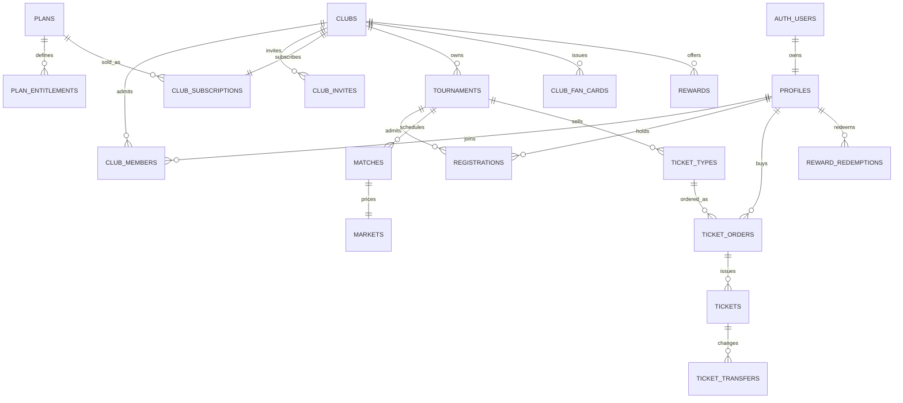

# MatchPulse — Domain Model

> **How to read this document.** It defines the v3.0.0 entities, relationships,
> user journeys and business invariants. Enforcement mechanisms and evidence are
> recorded per rule in the [invariants registry](../methodology/checkpoint-A/02-invariants.md).
> Runtime behaviour and infrastructure are in the [system overview](./01-system-overview.md).

## 1. Entities

| Entity | Meaning | Storage | State |
| :--- | :--- | :--- | :--- |
| **Profile** | A global email/password identity with a username and point balance. Every fan, club member and platform admin has one. | `profiles` | Implemented and verified |
| **Club** | The paying tenant. Owns events, members, subscriptions and club-scoped data. | `clubs` | Implemented and verified |
| **Club membership** | Links a profile to a club with `OWNER`, `ADMIN`, `STAFF` or `ANALYST`. A user may belong to several clubs. | `club_members` | Implemented and verified |
| **Club invite** | Single-use, expiring invitation for an email and club role. | `club_invites` | Implemented |
| **Platform admin** | Separate platform-level operator capability, not a club role. | `platform_admins` | Implemented and verified |
| **Plan and entitlement** | `STARTER`, `PRO`, `ELITE` and their feature/limit rows. | `plans`, `plan_entitlements` | Implemented and verified |
| **Subscription** | A club's plan and `ACTIVE`/`PAST_DUE`/`CANCELED` status. Only `ACTIVE` grants entitlements. | `club_subscriptions` | Implemented and verified |
| **Event (tournament)** | A club-owned competition with capacity, ticket allocation and a `DRAFT`/`PUBLISHED`/`FINISHED`/`CANCELLED` status. | `tournaments` | Implemented and verified |
| **Registration** | Links a fan to an event and consumes one participant place. | `registrations` | Implemented and verified |
| **Match** | A fixture with teams, kickoff, status, scores and a prediction flag. | `matches` | Implemented |
| **Market** | A three-outcome LMSR market attached to a match. | `markets` | Implemented and verified |
| **Position / trade / payout** | A fan's holding, the trade log and the one-time resolution credit. | `market_positions`, `market_trades`, `market_payouts` | Implemented and verified |
| **Trade request** | Idempotency key for one entry or exit. | `trade_requests` | Implemented and verified |
| **Entry cooldown** | Per-profile, per-market re-entry gate. | `market_entry_cooldowns` | Implemented |
| **Ticket type** | Club-defined sector, simulated price, allocation, sales window, max per buyer and fan-card/transfer/away rules. | `ticket_types` | Implemented and verified |
| **Ticket order** | A buyer's simulated order for 1–4 tickets, with terms, request id and `WEB`/`BOX_OFFICE` channel. | `ticket_orders` | Implemented and verified |
| **Ticket** | One nominal attendee ticket with identity fields, unique code and check-in time. The buyer may differ from the attendee. | `tickets` | Implemented and verified |
| **Ticket transfer** | The previous and new attendee for a name change. | `ticket_transfers` | Implemented |
| **Fan card** | A club-issued card number used by restricted ticket types. | `club_fan_cards` | Implemented |
| **Reward / redemption** | A club-scoped points reward and its one-time local code. | `rewards`, `reward_redemptions` | Implemented |
| **Audit event** | Actor, action, entity, optional club and metadata for sensitive actions. | `audit_events` | Implemented |

## 2. Relationships

- A club has one owner; `club_members` has a partial unique index for `OWNER`.
- A club has one subscription; only `ACTIVE` grants entitlements.
- A ticket type belongs to one event; an order belongs to one ticket type and one event; each ticket belongs to one order and one attendee.
- A buyer may hold several tickets for one event, up to the ticket type's max (default 4).
- A club sees only its own events, orders, attendees and aggregate insights.

## 3. State transitions

| Object | States | Trigger |
| :--- | :--- | :--- |
| Subscription | `ACTIVE` ↔ `PAST_DUE` → `CANCELED` | Platform admin or simulated plan change |
| Event | `DRAFT` → `PUBLISHED` → `FINISHED` / `CANCELLED` | Club staff; publish requires an active ticket type |
| Ticket order | `SIMULATED_PAID` → `CANCELLED` | Simulated checkout; no real payment |
| Ticket | valid → checked in; transferable → new attendee | Staff check-in or buyer name change before the deadline |
| Match | `SCHEDULED` → `LIVE` → `FINISHED` | Club staff |
| Market | `OPEN` → `RESOLVED` | `resolve_market`; terminal, one-shot |
| Position | shares `> 0` → `0` | Exits; settlement pays winners |
| Trade request | `IN_PROGRESS` → `COMPLETED` or rollback | Idempotent entry/exit |
| Cooldown | level `0…40`; wait `5, 15, 30, 45, …` capped at `600 s` | Accepted entries escalate; quiet time decays; refusals do not change it |

## 4. User journeys

1. **Fan sign-up/sign-in:** email/password creates or restores a profile with 200 points. No anonymous session.
2. **Club onboarding:** a user creates a club, becomes `OWNER`, chooses a simulated plan and invites staff. The platform admin can override the plan/status.
3. **Event and ticket setup:** club staff create a draft event, ticket types with rules, matches and an optional market; publishing requires at least one active ticket type.
4. **Fan purchase:** a fan opens a published event, chooses a ticket type and 1–4 attendees, enters identity data, accepts the club terms and buys. The buyer cap is cumulative per event across orders and channels. The order is simulated; each ticket gets a code/QR.
5. **Check-in and name change:** staff check in by code (idempotent); a buyer may transfer a transferable ticket to a new named attendee before the deadline.
6. **Prediction:** once the market opens, a fan enters a points position, may exit part or all, and is subject to the entry cooldown. New entries stop when the match is `FINISHED`; exits remain available while the market is open. Retries are idempotent.
7. **Resolution:** club staff resolve the market once after the match is `FINISHED`, using the score-derived winner; winning shares pay one point each and losing shares pay nothing.
8. **Rewards:** a fan redeems points for a club reward if they have a ticket for that club; the code is local and simulated. Redemption is retry-safe with a request key.
9. **Insights:** club staff/analysts read aggregate prediction choices and engagement for their own events; each outcome/time-bucket cohort below 5 is suppressed and no attendee identity is included. `ELITE` can export CSV.
10. **Admin and retention:** the platform admin manages clubs/plans and reviews audit. A service-role cleanup removes attendee identity from past-event tickets, transfer history, old fan-card audit metadata and invitation emails after the retention window.

## 5. Business invariants

This is a summary. The [registry](../methodology/checkpoint-A/02-invariants.md) is authoritative for enforcement details, test names and fault-injection evidence.

| Domain rule | Enforcement | Status |
| :--- | :--- | :--- |
| Tournament capacity is never exceeded under concurrency; the stored counter matches stored rows | `register_for_tournament` + CHECK constraints | **Verified** (INV-01, fault-injected, CI) |
| A participant cannot register twice for a tournament | Unique constraint + idempotent refusal | **Verified** (INV-02, fault-injected, CI) |
| Trading opens at kickoff; new entries stop at `FINISHED`; exits remain available until resolution | Market-window and prediction-enabled triggers on `market_trades`; `open_trade` / `close_trade` | **Enforced, unverified by fault injection** (M-INV1; targeted tests pass, independent verification pending) |
| Entry/exit, position, balance and trade log succeed or fail together | Single database transaction | **Verified by forced-failure rollback** (M-INV2) |
| Cannot sell shares not held; holdings never negative | Position guard | **Verified** (M-INV3, fault-injected) |
| Balance never negative, including concurrent same-user requests | Profile row lock + conditional debit | **Verified** (M-INV4, fault-injected) |
| Sum of held shares equals the market's outstanding quantity | Transactional state update | **Verified** (M-INV5, fault-injected) |
| Resolution pays exactly one point per winning share, once, terminally, and only for the score-derived winner after `FINISHED` | `resolve_market` + result-binding trigger | **Enforced, unverified by fault injection** (M-INV6; targeted tests pass, independent verification pending) |
| Entry cooldown ladder and decay; exits never restricted | `open_trade` cooldown gate | **Verified** (M-INV7, fault-injected) |
| No commission on entry, exit or settlement | No fee path; exact payout formulas | **Verified** (M-INV8, fault-injected) |
| A caller must be a real auth user; a fan acts only on their own rows | Supabase Auth, RLS, `auth.uid()` | **Verified** (INV-05, A-INV1–A-INV2) |
| Only a club member with the right role may resolve a club market; legacy organizer ownership remains | `resolve_market` club/organizer check | **Verified** (v3 integration + CLI) |
| Direct table writes are denied; mutations go through authorized RPCs | Revoked grants, no write policies, `SECURITY DEFINER` RPCs | **Verified** (A-INV4) |
| The public trade feed exposes no identity | `market_public_trades` safe columns | **Verified** (A-INV5) |
| Club data is isolated; a member cannot read another club's orders, attendees or insights | Club-scoped RLS + RPC membership checks | **Verified** (v3 integration) |
| Plan entitlements and limits are enforced in the database | `has_entitlement`, subscription status, RPC checks | **Verified** (v3 integration/CLI) |
| A buyer can buy 1–4 named tickets; identity fields and terms are required | `purchase_ticket` transaction | **Verified** (v3 integration/CLI) |
| Ticket sales never exceed capacity or allocation | Ticket type/event locks, capacity triggers and configuration guard | **Enforced, unverified by independent verification** (T-INV5; targeted tests pass) |
| Ticket purchase replays only the same payload; check-in is idempotent | Request id + stored payload hash + ticket code guard | **Enforced, unverified by independent verification** (T-INV13; targeted tests pass) |
| Fan-card, transferability and transfer-deadline rules are enforced | Ticket type rules + attendee validation | **Verified** (v3 integration) |
| Clubs see aggregate prediction data only; each outcome/time-bucket cohort below 5 is suppressed; no attendee identity | `club_prediction_insights`/`club_prediction_timeseries` + privacy rule | **Enforced, unverified by independent verification** (T-INV8; skewed-cohort test passes) |
| Attendee identity is removable after the retention window without losing the ticket/order/audit | `cleanup_expired_attendee_data` + transfer/audit/invite redaction | **Enforced, unverified by independent verification** (T-INV10; retention tests pass) |
| The platform admin cannot impersonate or change fan points | Scoped admin RPCs + audit | **Verified** (v3 integration) |
