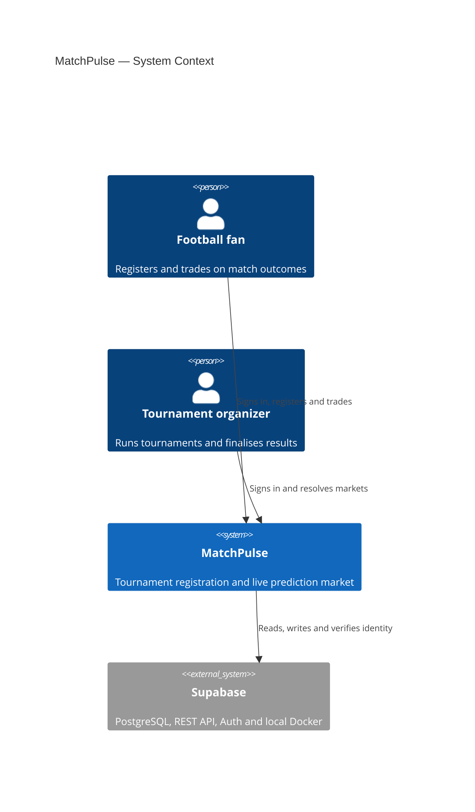
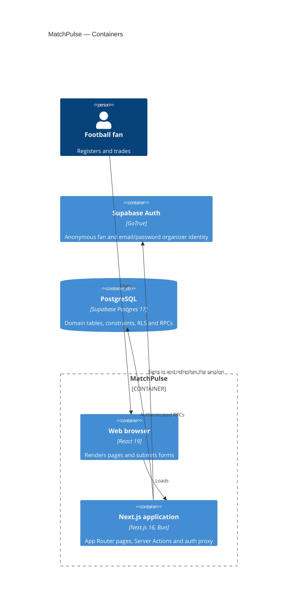
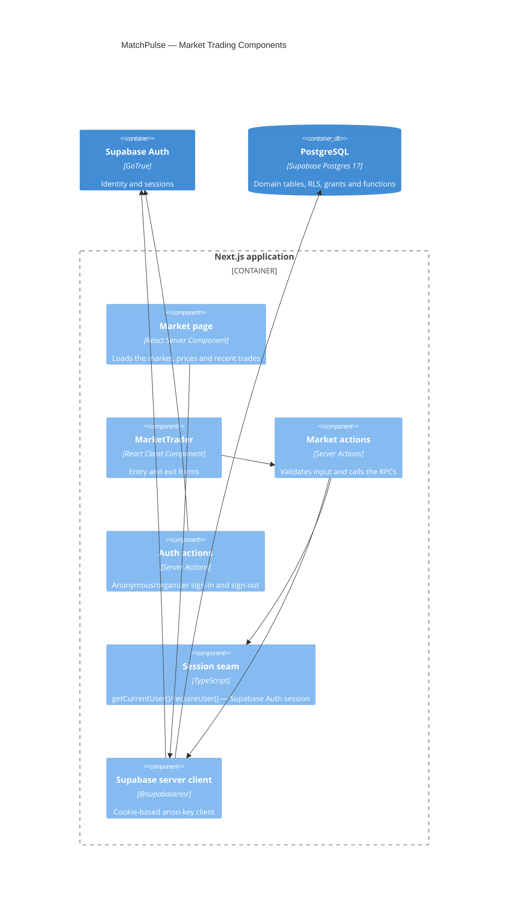

# MatchPulse — C4 Diagrams

> **How to read this document.** Three C4 views, all written in Mermaid so they
> render directly from the repository. They describe the current prototype:
> elements that do not exist yet are labelled **Planned**. The authoritative
> structure is the code and the [code map](./04-code-map.md).

## Level 1 — System context

Who uses MatchPulse and which external systems it depends on.

The club representative is a planned actor: the insights product is **not
implemented**, so the actor is omitted from the picture. The Supabase dependency
is real, including Auth; analytics is not.

## Level 2 — Containers

The deployable/runtime pieces inside MatchPulse.

There is one application container. Server Components and Server Actions run
inside it; the browser does not query the database directly. Supabase Auth is
implemented: fans use anonymous sign-in, organizers use email/password, and the
database verifies the JWT through `auth.uid()`.

## Level 3 — Market trading components

The components that implement the market path inside the Next.js container.

`resolve_market` exists in the database and is authorized by the organizer role;
there is no browser management component yet, so it is exercised in tests. The
session seam reads Supabase Auth; the database still enforces every rule with
`auth.uid()`.
