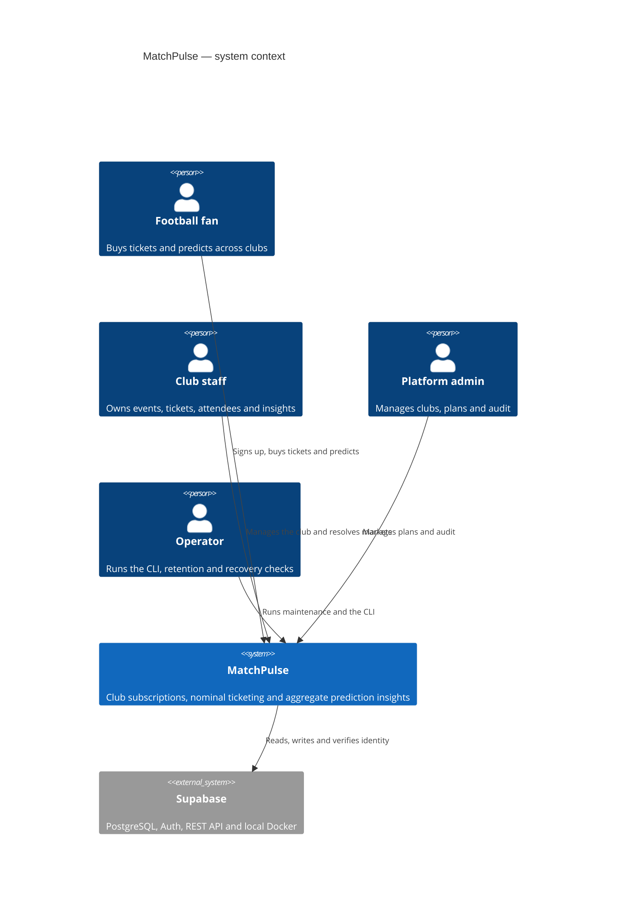
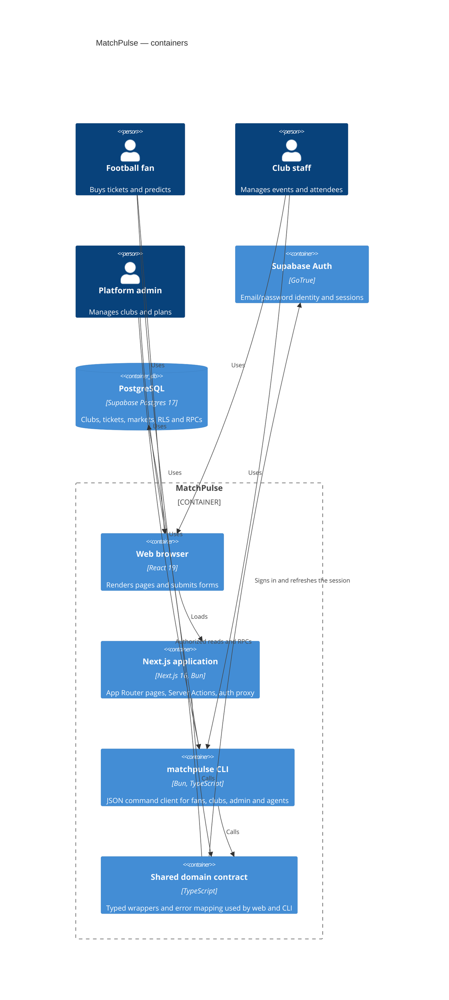
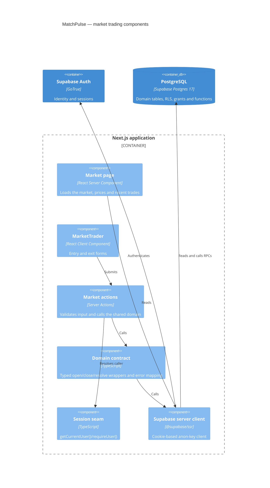
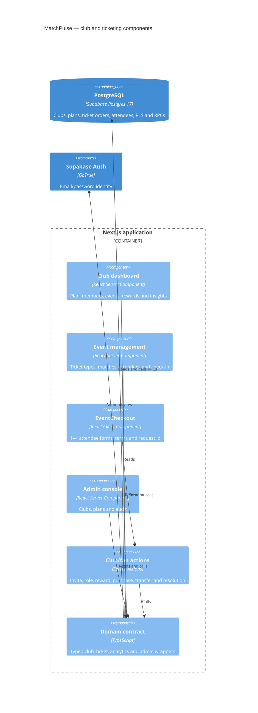

# MatchPulse — C4 Views

Four views of the current prototype. The code and
[code map](./04-code-map.md) remain authoritative. Elements that do not exist are
not drawn.

## Level 1 — System context

## Level 2 — Containers

There is one application container and one CLI. The browser does not query the
database directly. All users use email/password; the service role is an
operator/fixture credential outside the application runtime.

## Level 3 — Market trading components

`resolve_market` is club-aware: a club `OWNER`/`ADMIN`/`STAFF` may resolve a club
market; the legacy organizer rule remains for non-club markets. The CLI exposes
`club predictions resolve`.

## Level 3 — Club and ticketing components

Attendee identity is operational data for the club's own event. Prediction
insights are aggregate-only, with cohorts below 5 suppressed; the two data
surfaces are deliberately separate.
