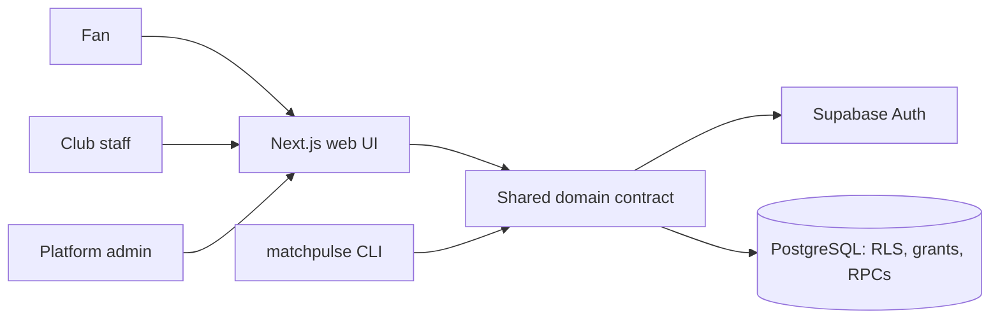

# MatchPulse — Architecture Description

| | |
| :--- | :--- |
| **Date** | 2026-11-10 |
| **Courses** | Software Architectures (CM0639 module 1) and Development Methodologies |
| **Code** | v3.0.0 plus the v3.1.0 security and integrity remediation (unreleased) |
| **Reading time** | A 3-minute walkthrough is below; the reference tables are for questions |

## 1. What MatchPulse is

MatchPulse is a club-first football ticketing and fan-engagement platform. A club
subscribes to a plan, creates events and matches, sells named tickets, checks
attendees in, and reads aggregate prediction insights for its own matches. Fans
use one email/password account to buy tickets and predict with points across
clubs. A platform admin manages clubs, plans and audit. Commerce is simulated.

The hard part is not the screen. It is keeping capacity, points, ticket codes,
club isolation and resolution correct when many fans act at the same time.

## 2. Three-minute walkthrough

> MatchPulse is a course prototype for club ticketing and match-day prediction.
> The user is a club organizer. The problem is that ticket sales, attendee lists,
> check-in and post-match sentiment are usually spread across spreadsheets and
> separate tools. At kickoff, an application-level check fails: tickets can be
> oversold, points can be charged twice, a winning share can be paid twice, or one
> club can see another club's data.
>
> I built one Next.js application and one PostgreSQL database. The web UI and the
> CLI are two clients of the same typed domain contract. The database is the
> system of record and the authorization boundary: RLS, grants and
> `SECURITY DEFINER` functions check the caller, the club, the role and the plan.
>
> The structure is a modular monolith. The modules are identity and access,
> clubs and plans, events and matches, ticketing, prediction market, insights and
> privacy, and admin and audit. They communicate through SQL calls inside one
> transaction, not through a network. I did not split into microservices because
> there is one developer, one database and one deployment, and the domain needs
> strong consistency, not independent scaling.
>
> The main decisions are: Supabase Auth for email/password identity; one database
> with RLS and transactional functions; club tenancy with database-enforced
> entitlements; nominal tickets with a buyer and named attendees; and a
> result-bound, one-shot prediction market.
>
> The trade-off is deliberate. Pessimistic locks protect balances and capacity
> but reduce peak throughput. Database-centric rules are hard to bypass but tie
> the design to PostgreSQL. One deployable keeps operations simple but prevents
> independent scaling. Those are acceptable for this prototype.
>
> What I do not claim: there is no hosted deployment, no production recovery, no
> real money, no independent user study and no third-party security audit. The
> evidence is local and CI-based. The architecture is modular enough to extract a
> module later if a measured driver appears, but I have not done that.

## 3. Structure

There is no broker, cache, worker or separate service. A request is a synchronous
call from the browser or CLI to the Next.js/domain layer, then to a transactional
PostgreSQL function. That is enough for the current domain and avoids distributed
consistency problems the product does not need.

## 4. Modules and boundaries

| Module | Responsibility | Main storage |
| :--- | :--- | :--- |
| Identity and access | Supabase Auth, profile, platform admin flag, membership and role checks | `profiles`, `club_members` |
| Clubs and plans | Tenancy, invitations, plans, entitlements, subscription status | `clubs`, `plans`, `club_subscriptions` |
| Events and matches | Draft/publish, capacity, ticket allocation, kickoff, scores | `tournaments`, `matches` |
| Ticketing | Ticket types, nominal orders, attendee identity, code/QR, transfer, check-in, retention | `ticket_types`, `ticket_orders`, `tickets` |
| Prediction market | LMSR pricing, entry/exit, cooldown, idempotency, resolution | `markets`, `market_positions`, `market_trades` |
| Insights and privacy | Club-scoped aggregates, cohort suppression, audited export | `club_prediction_insights`, `audit_events` |
| Admin and audit | Clubs, plans, subscription status, audit; no impersonation | `platform_admins`, `audit_events` |

**Boundaries.** Client components do not import the server Supabase client.
Server Actions validate input and call authorized RPCs; they do not mutate tables
directly. Mutation RPCs are `SECURITY DEFINER`, resolve `auth.uid()`, fix
`search_path` and grant execute only to `authenticated`. Direct table writes are
revoked. The service-role key is a fixture/test/maintenance credential, never an
application runtime key.

## 5. Key decisions

| Decision | Why | Record |
| :--- | :--- | :--- |
| Next.js + Supabase + PostgreSQL | One developer, two course deadlines; database-enforced rules; local tooling | [ADR-001](../adr/001-use-nextjs-and-supabase.md) |
| Authentication, RLS, grants and `SECURITY DEFINER` RPCs | Direct writes would bypass business rules; the UI is not the boundary | [ADR-003](../adr/003-authorization-rls.md) |
| Club tenancy and database-enforced plans | Clubs are the paying tenant; a hidden button is not an entitlement check | [ADR-007](../adr/007-club-tenancy-and-entitlements.md) |
| Nominal ticketing with buyer vs attendee | Clubs need named attendees and event-access identity, not a ticket count | [ADR-010](../adr/010-nominal-ticketing-and-attendee-identity.md) |
| Result-bound, one-shot prediction market | Resolution must match the final score and stay terminal | [ADR-011](../adr/011-result-bound-market-lifecycle.md) |
| Separate platform admin | Platform operation is not a club role; no impersonation | [ADR-008](../adr/008-platform-admin-and-operator-boundary.md) |

## 6. Where the code is

| Element | Location |
| :--- | :--- |
| App Router pages | `src/app/` — fan, club, admin, events, market |
| Server Actions | `src/app/actions/` — auth, market, tickets, v3 |
| Shared domain contract | `src/lib/domain/` — auth, clubs, events, tickets, predictions, analytics, admin |
| CLI | `src/cli/` — command tree, profiles, JSON output |
| Database | `supabase/migrations/` — 29 migrations |
| Tests | `tests/invariants/`, `tests/integration/`, `tests/agent/`, `tests/e2e/` |
| Architecture guard | `scripts/check-architecture.ts` |
| CI | `.github/workflows/ci.yml` — five jobs |

## 7. Agile and evolution

This is an **evolutionary architecture**, not a big design up front. The domain
contract is stable, but the implementation moves in small slices with tests and
fault injection. The five characteristics are fitness functions. Decisions are
recorded in ADRs; a change that alters boundaries or ownership needs a new ADR.
If a measured driver appears — independent scaling, a different data owner, a
regulatory boundary — a module can be extracted. No such driver exists today.

## 8. What is not claimed

- No hosted deployment, TLS, DNS, external monitoring or alerting.
- No production backup, retention, RTO/RPO or disaster recovery.
- No real payments, KYC, invoices, refunds or settlement.
- No independent user study, security audit or privacy audit.
- No seat maps, wallet passes, turnstile hardware or FIGC/Questura integration.

## 9. Detail

- Full architecture reference: [architecture README](../README.md)
- Requirements: [kata](../kata.md) and [requirements](../requirements.md)
- Characteristics: [03-architecture-characteristics.md](../03-architecture-characteristics.md)
- C4 views: [05-c4-diagrams.md](../05-c4-diagrams.md)
- Code map: [04-code-map.md](../04-code-map.md)
- ADRs: [adr/](../adr/)
- Invariants and evidence: [registry](../../methodology/checkpoint-A/02-invariants.md)
- AI use: [ai-use.md](../../methodology/ai-use.md)
